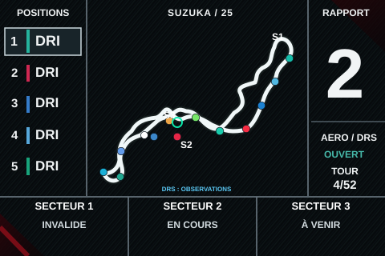

# 📚 Catalogue des dashboards F1L

[← Retour à l'accueil](README.md)

Les dashboards présentés ici sont **téléchargeables gratuitement**. Chaque modèle dispose d'un lien de téléchargement et, lorsque disponible, d'un aperçu.

**Important : 8 dashboards personnalisés maximum** peuvent être installés simultanément sur le volant. Si les emplacements sont occupés, supprimez d'abord un dashboard personnalisé.

## Modèles disponibles

| Aperçu | Modèle | Téléchargement |
|:---:|---|---|
|  | **F1 V2 — 4 pages** Course · Voiture · Moteur · Circuit | **[⬇️ Télécharger (.f1l)](https://github.com/matthieumartin09/F1L-updates/releases/download/R2F172/F1_V2_CIRCUIT.f1l)** [Voir les 4 pages](#f1-v2--4-pages) |

## F1 V2 — 4 pages

**Quatre pages — affichage F1L 480 × 320 pixels.**

| Page 1 : Course | Page 2 : Voiture |
|:---:|:---:|
|  |  |
| Page 3 : Moteur | Page 4 : Circuit |
|  |  |

**Page 4 : Circuit** — carte à cadrage fixe, positions des voitures, secteurs et informations DRS selon les données disponibles. L’aperçu est une illustration statique reconstituée à partir de la simulation R2F169 ; ce n’est pas une capture d’une session réelle sur le volant.

Sur la page **Course**, les données de télémétrie incluent notamment le tour en cours, le meilleur tour violet, le rapport suggéré et les RPM. Les pages **Voiture** et **Moteur** conservent leur présentation.

### Télécharger et installer

**[⬇️ Télécharger F1 V2 — 4 pages (.f1l)](https://github.com/matthieumartin09/F1L-updates/releases/download/R2F172/F1_V2_CIRCUIT.f1l)**

Le fichier du dashboard ci-dessus est celui distribué avec **R2F172**. Son empreinte SHA-256 est :

`d13af3df133bfe08516080a06f0e05c14664caa580ddc099883b29108522ba45`

Pour bénéficier des fonctions de la page Circuit, utilisez le **firmware [R2F172](https://github.com/matthieumartin09/F1L-updates/releases/tag/R2F172) ou une version ultérieure compatible**.

1. Téléchargez le fichier `F1_V2_CIRCUIT.f1l`.
2. Ouvrez la page Web de votre volant F1L compatible.
3. Utilisez **ADD DASHBOARD**, sélectionnez le fichier, puis suivez les indications du volant.
4. Sélectionnez le dashboard sur le volant et parcourez ses quatre pages.

**Si vous possédez déjà exactement `F1_V2_CIRCUIT.f1l`**, aucun nouvel import n'est nécessaire pour passer de R2F169 à R2F172 : le dashboard est inchangé.

**État des essais :** les contrôles sur PC ne constituent pas une validation matérielle complète. La fluidité et le rendu du circuit restent à vérifier en conditions réelles sur le volant. Aucun correctif des popups n'est revendiqué.

Pour les tracés et les informations de licence : [sources et licences des cartes](https://github.com/matthieumartin09/F1L-updates/releases/download/R2F172/CARTES_SOURCES_LICENCES.zip).

### Ancienne version — 3 pages

Pour conserver l'accès à l'ancien modèle : [télécharger F1 V2 — 3 pages](https://raw.githubusercontent.com/matthieumartin09/F1L-updates/main/F1_V2.f1l). Cette archive n'est plus le dashboard mis en avant.

## Comment installer un dashboard ?

1. Téléchargez le fichier `.f1l` du modèle choisi.
2. Ouvrez la page Web d'un volant **F1L compatible**.
3. Sélectionnez **ADD DASHBOARD** (ou la fonction équivalente) puis le fichier téléchargé.

**Ne pas confondre :** un dashboard `.f1l` n'est **pas** un firmware. Ne le flashez pas par USB et ne l'utilisez pas comme mise à jour OTA.

[← Retour à l'accueil](README.md)
