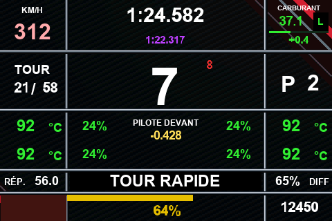

# F1L — Mises à jour de votre volant

Ce projet communautaire **non officiel** permet de mettre à jour certains volants **F1L / MVH**.

## Toujours obtenir la dernière version

**[Ouvrir la dernière version publiée](https://github.com/matthieumartin09/F1L-updates/releases/latest)**

C'est le lien permanent à partager aux utilisateurs déjà équipés de F1L. Il suit automatiquement la release marquée « Latest » : aucun numéro de version à modifier dans le lien.
Un ancien fichier déjà téléchargé conserve sa version ; téléchargez à nouveau depuis ce lien pour obtenir la dernière publication.

## Mettre à jour directement depuis le volant

À partir de R2F154, lorsque le volant dispose du Wi-Fi de la box enregistré :

1. Au démarrage, laissez le volant connecté à ce Wi-Fi. Il recherche une mise à jour sur GitHub en arrière-plan.
2. Si l'icône orange apparaît sur l'écran d'attente, faites un **appui long sur Settings**.
3. Confirmez par un **second appui court sur Settings**. Haut/Bas annule ; la proposition expire après 15 secondes.
4. Laissez l'installation et le redémarrage se terminer, puis vérifiez la version dans **Settings**.

Ce parcours ne nécessite ni PC, ni téléphone, ni connexion au point d'accès `10.10.10.1`. La connexion Internet utilisée est celle du volant vers la box. La notification est masquée dès le début de la télémétrie.

### Si vous utilisez une version antérieure

1. Arrêtez la télémétrie et ouvrez **MVH Custom** comme d'habitude.
2. Choisissez **Rechercher une mise à jour**, puis **Installer**.
3. Après redémarrage, vérifiez la version installée dans Settings et dans la page Web, lorsque votre version propose cet affichage.

Gardez une alimentation stable pendant l'installation. La mention « Installation acceptée » ne confirme pas à elle seule que la nouvelle version a démarré.

## 📚 Bibliothèque de dashboards

Découvrez les dashboards F1L en accès libre. Chaque modèle dispose d'un aperçu, d'une description et d'un lien de téléchargement. Les prochains modèles seront ajoutés dans ce même catalogue.

**Limite d'installation : 8 dashboards personnalisés maximum sur le volant.** Pour en installer un nouveau lorsque les 8 emplacements sont occupés, supprimez d'abord un dashboard personnalisé existant.

| Aperçu | Dashboard et téléchargement |
|:---:|---|
|  | **F1 V2** — 3 pages : Course, Voiture et Moteur. **[Télécharger le dashboard (.f1l)](https://raw.githubusercontent.com/matthieumartin09/F1L-updates/main/F1_V2.f1l)** [Voir les 3 pages](DASHBOARDS.md#f1-v2) |

**[Voir tous les dashboards et leurs aperçus](DASHBOARDS.md)**

**F1 V2 corrigé exige R2F165 : mettez d’abord le firmware à jour, puis importez le dashboard.** RPM blanc, tour en cours, meilleur tour violet et rapport suggéré ; le bloc fixe « Pilote derrière » est retiré. Pages 2 et 3 conservées. Essais matériels à effectuer ; le problème des popups reste non résolu.

Pour installer un dashboard sur un volant compatible, utilisez **ADD DASHBOARD** depuis la page Web du volant et choisissez le fichier `.f1l`. Ce fichier n'est pas un firmware ; ne l'utilisez ni en flash USB ni comme mise à jour OTA.

*La page 1 montre un rendu du fichier corrigé avec des valeurs de télémétrie simulées ; les pages 2 et 3 montrent les fonds originaux.*

## 🔒 Première installation — Accès réservé

Le programme de première installation est **distribué uniquement aux personnes autorisées**. Il n'est pas proposé en téléchargement libre sur cette page.

Si vous avez reçu ce programme directement, suivez **uniquement les instructions qui l'accompagnent**.

**Important :** une première installation avec une image complète peut effacer les réglages et dashboards personnels du volant. Effectuez une sauvegarde avant toute installation.

## ℹ️ À savoir

- Vérifiez la compatibilité de votre volant avant toute installation.
- Ne coupez pas l'alimentation pendant une mise à jour.
- Gardez un moyen de dépannage par USB en cas de problème.
- L'installation d'un **dashboard** et la mise à jour du **programme du volant** sont deux opérations différentes.

[Informations complémentaires et précautions](PUBLICATION.md)

---

*Projet communautaire non officiel, indépendant de MVH Studios.*

